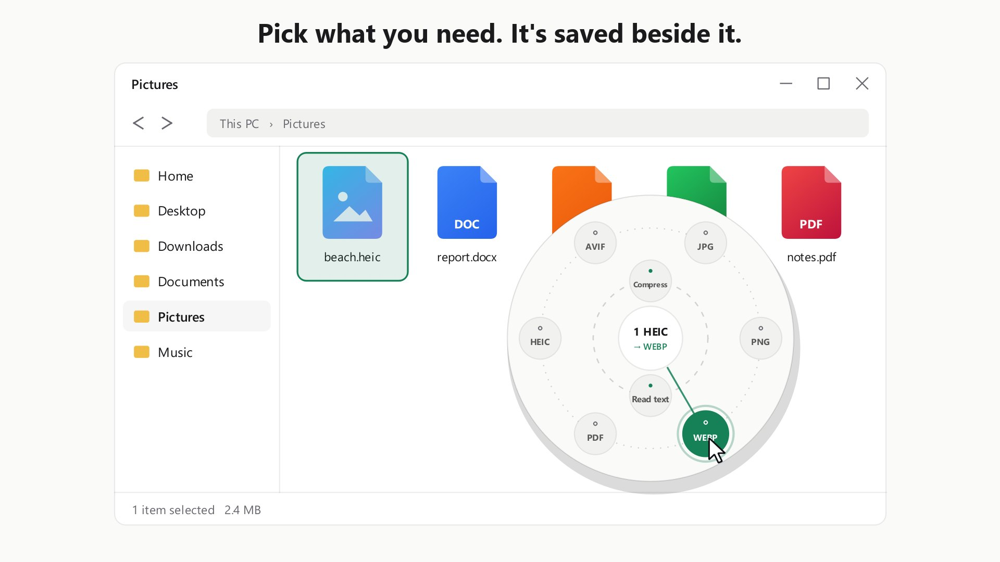

<div align="center">

<a href="https://github.com/syedtaj7/DeskVert/releases/latest"></a>

<br>

<a href="https://github.com/syedtaj7/DeskVert/releases/latest"></a>

<a href="https://github.com/syedtaj7/DeskVert/releases/latest"></a>
<a href="https://github.com/syedtaj7/DeskVert/releases"></a>

<a href="LICENSE"></a>
<a href="https://github.com/syedtaj7/DeskVert/actions/workflows/release.yml"></a>

<br><br>

<a href="https://deskvert-website.vercel.app/assets/media/deskvert-demo.mp4"></a>

**[▶ Watch the 20-second demo](https://deskvert-website.vercel.app/assets/media/deskvert-demo.mp4)**

<br>


**Tap, don't drag.**<br>
Deskvert waits in your tray and works on the files you've already selected.<br>
Tap <kbd>Ctrl</kbd> + <kbd>Shift</kbd>, pick a format, and the new file lands beside the original, checked before you see it.

</div>


## ⌨️ Tap, don't drag


Select some files in File Explorer or on the desktop, press <kbd>Ctrl</kbd> and <kbd>Shift</kbd> together and let go.
The **orbit** opens at your pointer with only the choices that fit what you selected: formats on one ring, tools on
the other. Related tools fan out when you point at them (**Split** opens *in half*, *every N pages*, *by ranges*,
*every page*), and a small card says what each does and what the new file will be called. `photo.heic` becomes
`photo.webp` in the same folder.

- **One file or five hundred,** and folders too: their files are converted, the folders stay where they are.
- **Your shortcuts keep working:** <kbd>Ctrl</kbd>+<kbd>Shift</kbd>+<kbd>T</kbd> and the rest do what they always did.
- **Nothing is overwritten,** and **Undo** on the result card sends new files to the Recycle Bin.


## ✅ Checked before you see it

Every result is made in a private folder, **opened again and compared with the original**, and only then moved next
to it. If a check fails, nothing is saved and you're told why in plain words.

| Converting | What's compared |
|---|---|
| Pictures | Size and pixels (lossless formats pixel for pixel), rotation, colour profile |
| PDF → Word | Every word of the PDF is in the document |
| Word, Excel, PowerPoint | Page counts, words, every spreadsheet cell, slides and their shapes |
| Sound, and sound from videos | Its length, against the sound track itself |
| Data files | Values like `007`, `1.50` and long IDs, exactly as written |
| Maps, subtitles, fonts | Every place and coordinate, every cue, every font table |
| Pictures traced to SVG | The drawing is drawn again and compared with the picture |


## 🌐 The web counts too

Edge, Chrome, Brave, Firefox and Opera, with nothing to add to the browser. Point at a link, select some text or a
table, or hold <kbd>Ctrl</kbd> + <kbd>Shift</kbd> while you pull something out of a page.

| You do | You get |
|---|---|
| **Drag a picture** with <kbd>Ctrl</kbd> + <kbd>Shift</kbd> held, drop it on the circle | The picker for that picture: JPG, PNG, PDF, compress, crop… Always the **biggest size the page offers**, not the small preview |
| **Select some text** on a page, tap <kbd>Ctrl</kbd> + <kbd>Shift</kbd> | Choices made for a selection: a clean **PDF**, Word, Markdown, plain text or a picture of it, with a line saying where it came from |
| **Select a table** the same way | **Excel**, one sheet per table (merged cells spread out, numbers as numbers), or CSV |
| **Tap** <kbd>Ctrl</kbd> + <kbd>Shift</kbd> on a browser window with nothing selected | The page as a **PDF** or **one long picture** (made by the Edge or Chrome already on your PC), **just the article** as a clean PDF (no ads, menus or cookie banners), **every picture** on the page in one folder, or a **QR code** of its address |
| **Point at a link** and tap <kbd>Ctrl</kbd> + <kbd>Shift</kbd> | What it points to: a linked **PDF, picture or file** is fetched; a linked page gives that page's choices |
| **Drag a link** in | A **QR code** that's read back before saving, so it always scans |
| **Drag a Google Drive, Docs, Dropbox or OneDrive share link** | The **file itself**, with its real name (Docs, Sheets and Slides come as Word, Excel and PowerPoint) |
| **Win + Shift + S**, then tap <kbd>Ctrl</kbd> + <kbd>Shift</kbd> | Your snip (or any copied picture) in the picker: save it as PNG, JPG, PDF, read its text… |
| Pick **Website icons** on a logo | favicon.ico, the PNG sizes phones use, a web manifest, and the lines to paste into your site |
| Turn on **WEBP downloads to JPG** (Settings) | Pictures you download as WEBP or AVIF get a JPG copy next to them, by themselves |

To read a selection, Deskvert copies it and then puts your clipboard back exactly as it was. Everything lands in **Downloads\Deskvert**, never overwriting anything. Videos on sites like YouTube are streams: dragging one gives its thumbnail, and Deskvert doesn't download streaming video.


## 🧰 Small jobs, done in place


| Tool | What you get |
|---|---|
| 🗜️ **Compress images** | Pick **under 20 KB, 50 KB, 100 KB, 200 KB, 500 KB or 1 MB**, or drag a quality slider. Every choice shows the quality % and the new size *before* you click. The limit is always respected. **For forms:** exact-size JPGs for applications: photo (200×230, 20–50 KB), passport photo (35×45 mm), signature (140×60, empty paper trimmed), or your own width × height × KB. |
| 📄 **PDF toolkit** | **Sign** with your name in handwriting or a picture of your signature · **Compress** to a size limit (under 200 KB, 500 KB, 1 MB, 2 MB, or your own) at the best quality that fits, or by level · **Lock / Unlock** with an AES-256 password · **Split** in half, every N pages, by ranges or every page · keep or remove **Pages** (`1-3, 7, 10-end`) · **Reorder** or **Reverse** · **Rotate** · page **Numbers** · **2, 4, 6 or 9 pages per sheet** · **Watermark** · **Flatten** forms · **Clean info** (author, dates, hidden data) · **Grayscale** · save the **Pictures** inside · **Merge** · pictures and PDFs **combined** into one PDF · → **Markdown**, **HTML**, **EPUB**, **TIFF**, **one long image**, **CBZ** |
| 🔍 **Read text (OCR)** | Text from photos and scanned PDFs, or a **searchable PDF** that looks exactly like the scan. Uses the engine built into Windows, so nothing extra is downloaded. Sideways scans are turned upright automatically. |
| 📦 **Zip & extract** | ZIP the selected files · extract **ZIP, 7Z, RAR, TAR, GZ, BZ2, XZ, ZST, CAB, ISO** · repack any archive as a ZIP |
| 📊 **Data files** | CSV / TSV / Excel / JSON / **YAML** / **TOML** / **XML** / **JSON Lines** into each other · Excel sheets → CSV each, without Excel · **vCard contacts** ↔ CSV / Excel · **tidy** or **minify** JSON. Values like `007`, `1.50` and long IDs stay exactly as written. |
| 🗺️ **Maps** | **GeoJSON, KML, KMZ, GPX** and **Shapefiles** into each other, to CSV or Excel, and a CSV with coordinates → map file |
| 🧊 **3D models** | **STL, OBJ, PLY, 3MF, GLB/glTF** into each other, plus a shaded **picture** of the model |
| 📐 **CAD** | **DXF** → **PDF**, **SVG** or **PNG**, without AutoCAD |
| 🔤 **Fonts** | **TTF / OTF ↔ WOFF**, → **EOT** |
| 🎵 **Sound & video** | **MP3, M4A, WAV, FLAC, WMA** (and AAC, OGG, Opus, AIFF in) into each other · **Trim** a recording to the part you need · the **sound from a video** (MP4, MOV, MKV, AVI, WMV...) · a **still picture** of any moment of a video, a **frames sheet** of nine moments, or a few seconds as a looping **GIF**. Uses Windows' own converter and decoder, so nothing is downloaded and it stays light. Videos themselves aren't re-encoded. |
| ✉️ **Mail & saved pages** | **EML** and **Outlook .msg** e-mails (no Outlook needed) and **MHTML** pages → **PDF**, **HTML**, **TXT**, **Markdown**; e-mail attachments → **ZIP** |
| 📝 **Markdown** | → **PDF** (A4, with headings, tables, code and images) · **HTML** · **Word** |
| 🖼️ **Picture edits** | **Trace to SVG** (logos, icons, drawings) · **Turn** left, right or upside down · **Mirror** · **Grayscale** · **Resize** (half, 1920, 1280 or 1080 px) · **Clean info**: removes location, camera and date before you share (JPG and PNG aren't re-encoded) · **Long image**: several pictures stitched one under the other |
| 📚 **E-books** | **EPUB, MOBI, FB2**, comics (**CBZ, CBR, CB7, CBT**) and XPS → **PDF**, **EPUB** or **TXT** · Markdown, HTML, TXT and PDF → **EPUB** · PDF → **CBZ**. No e-book software needed. |
| 💬 **Subtitles** | **SRT, WebVTT, ASS/SSA, SAMI, TTML, LRC, MicroDVD** into each other, saved as UTF-8 |


## 🔎 Which file have you got?


Type a file's ending into the [format finder](https://deskvert-website.vercel.app/#formats) to see everything it
can become, or read the [short guide for each conversion](https://deskvert-website.vercel.app/convert).

<details>
<summary><b>See what converts to what</b></summary>
<br>

| You select | You can make |
|---|---|
| **Images:** JPG, PNG, WEBP, HEIC, AVIF, GIF, BMP, TIFF, ICO, TGA, PSD, SVG, camera RAW | JPG, PNG, WEBP, HEIC, AVIF, GIF, BMP, TIFF, ICO, TGA, PDF, several images in one PDF · Compress · Crop to a shape · Watermark · Passport photo sheet · Read text |
| **PDF** | **Word (DOCX)**, PNG or JPG pages, text, Split, Merge · Compress · Lock / Unlock · Pages · Rotate · Numbers · Watermark · Tables to Excel · Remove blank pages · Read text · Searchable PDF |
| **Word:** DOCX, DOC, ODT, RTF, TXT, HTML | PDF, DOCX, ODT, RTF, TXT, DOC; and without Office: DOCX / ODT to TXT, Markdown, HTML |
| **Apple:** Pages, Numbers, Keynote | The preview saved inside, as PDF or JPG |
| **Excel:** XLSX, XLS, ODS | PDF, XLSX, CSV (first sheet), ODS, XLS |
| **PowerPoint:** PPTX, PPT, ODP | PDF, PPTX, ODP, PPT, PNG or JPG slides |
| **Data:** CSV, TSV, JSON | XLSX, JSON, CSV, tidy or minified JSON |
| **Databases (SQLite), settings (INI, .env, .properties), calendars (.ics)** | Excel or CSV per table; JSON or YAML; events as a table |
| **Markdown, Jupyter notebooks** | PDF, HTML, DOCX; notebooks to HTML (with charts), Markdown, Python |
| **Archives:** ZIP, 7Z, RAR, TAR, GZ, BZ2, XZ, ZST, CAB, ISO | Extract into a new folder, or repack as ZIP |
| **Audio, video** | Into each other, Trim; a still picture, a frames sheet or a GIF from a video; its sound |
| **E-mails:** EML, Outlook MSG | PDF, HTML, TXT, Markdown, attachments as a ZIP |
| **Any files** | ZIP the selection · SHA-256 checksum · **Rename** many at once (tidy copies by date or number) |

- **Office documents** are converted by your installed Microsoft Office, so they look exactly as they do in Office. Office opens hidden, read-only and with macros off, and your Office settings are never changed. **No Office?** The free **LibreOffice** is used instead when it's installed (in a private profile of its own).
- **Photos** keep their rotation, camera details (EXIF), GPS and color profile. Lossless formats are checked pixel for pixel.
- **Videos** are never re-encoded (that's heavy work): Deskvert takes their sound or a still picture, through Windows' own decoder.

</details>


## 🛡️ Your originals are never touched


- **Your original is never touched.** Every result is a new file, such as `report (compressed).pdf`, and nothing is overwritten.
- **Checked first** ([what's compared](#-checked-before-you-see-it)); a result that fails its checks is never saved.
- **Private.** Everything happens on your PC. No uploads, no account, no tracking.
- **Crash-proof.** Conversions run in separate worker processes, so a damaged file can't take Deskvert down.


## 🍃 Light on your laptop


Built for low-end laptops. Deskvert uses **no CPU while idle**. Every conversion runs under a **hard CPU limit that Windows itself enforces** (15%, 25% or 50%, your choice), at the lowest priority and in efficiency mode, so your laptop stays cool and quiet while you keep working.


## 🖼️ Screens

<table>
<tr>
<td width="50%"><br><sub><b>The picker</b>: point at an option to see what it does</sub></td>
<td width="50%"><br><sub><b>Welcome tour</b>: a minute to get going</sub></td>
</tr>
<tr>
<td><br><sub><b>Built-in guide</b> from the tray</sub></td>
<td><br><sub><b>Settings</b>: shortcut, quality, CPU limit, look</sub></td>
</tr>
</table>


## 📥 Install

1. Download **`Deskvert-Setup-x.y.z.exe`** from the [latest release](https://github.com/syedtaj7/DeskVert/releases/latest). No admin rights needed.<br>
   Prefer not to install? Get **`Deskvert-x.y.z-portable.zip`**, unzip it anywhere and run `Deskvert.exe`.
2. A short welcome tour shows you around.
3. Select a file, tap <kbd>Ctrl</kbd> + <kbd>Shift</kbd>, pick a format. That's it.

> [!NOTE]
> **"Windows protected your PC"?** Windows SmartScreen shows this for new apps that aren't widely downloaded yet. Click **More info → Run anyway**. Deskvert is open source: every release is built from this repository by GitHub Actions, and you can read every line.

**Needs:** Windows 10 or 11, 64-bit · about 250 MB of disk · no admin rights, no internet for converting.
Optional: Microsoft Office (or the free LibreOffice) for Word, Excel and PowerPoint files; Edge or Chrome (already on most PCs) for saving web pages.

**Check your download (optional):** each file's SHA-256 checksum is listed on its [release page](https://github.com/syedtaj7/DeskVert/releases/latest). In PowerShell: `Get-FileHash .\Deskvert-Setup-x.y.z.exe` should print the same value.

### Update

Deskvert lets you know when a new version is out (it asks GitHub every few hours; turn it off in
**Settings → General → Tell me about updates**). Click **Update**, or use **Settings → About → Check for updates**
(or the tray menu). If there's a new version, Deskvert shows what's new, downloads it with a progress bar, checks it against GitHub's checksum, then installs it and restarts. The portable zip links to the download page instead.

### Uninstall

Any of these works, and each removes everything (app, settings, logs):
- **Start menu → Uninstall Deskvert**
- **Tray icon → Uninstall Deskvert…**
- **Deskvert Settings → About → Uninstall**
- **Windows Settings → Apps → Installed apps → Deskvert → Uninstall**


## 🎛️ Day to day

| Action | How |
|---|---|
| Convert | Select files, tap <kbd>Ctrl</kbd> + <kbd>Shift</kbd>, click a format |
| Options (quality, pages, password…) | Right-click an option in the picker; tools ask when you click them |
| Every format | Point at a group: its choices fan out, and groups inside open fans of their own |
| Close the picker | <kbd>Esc</kbd>, click elsewhere, or tap the shortcut again |
| Copied files | If nothing is selected, files you copied with <kbd>Ctrl</kbd> + <kbd>C</kbd> are used |
| Watch folders | Settings → General → **Watch folders**: files you put in a chosen folder are converted by themselves (PDF, JPG, Compress...), into a "Converted" folder inside |
| Report a problem | Tray menu → **Report a problem**: you see everything first (names and folders hidden), then GitHub opens in your browser to post it. Deskvert sends nothing itself |
| Less motion | Settings → General → **Reduce motion**: still pictures instead of animations |
| Repeat the last action | Tap <kbd>Ctrl</kbd> + <kbd>Shift</kbd> twice, quickly |
| Convert from anywhere | While dragging a picture, link, table, text or file (from a browser, an e-mail, a chat...), hold <kbd>Ctrl</kbd> + <kbd>Shift</kbd> and drop it on the circle that appears |
| Save a web page | Tap <kbd>Ctrl</kbd> + <kbd>Shift</kbd> while a browser window is in front: PDF, one long picture, or a QR code |
| Convert a screenshot | Copy or snip a picture, then tap <kbd>Ctrl</kbd> + <kbd>Shift</kbd> anywhere |
| See it all | Tray icon → **Welcome tour**: the live picker, every format, and every conversion acted out |
| Many kinds of files at once | Select them all: each kind gets its own branch ("2 pictures", "1 PDF"), plus **Combine** and **ZIP** for everything |
| Right-click menu | Right-click files → **Convert with Deskvert** (Windows 11: Show more options) |
| Undo | Click **Undo** on the Saved card: the new files go to the Recycle Bin |
| Your presets and favourites | Settings → **Customize**: e.g. *WhatsApp photo* or *College PDF under 300 KB*, pinned closest to the centre. Recently used actions move there by themselves |
| Guide, settings, recent files | Right-click the Deskvert icon in the tray |

<details>
<summary><b>FAQ</b></summary>
<br>

**Ctrl + Shift switches my keyboard layout.** Choose <kbd>Ctrl</kbd> + <kbd>Shift</kbd> + <kbd>Space</kbd> in Settings → Shortcut &amp; look.

**Do I need Microsoft Office?** Only for Word, Excel and PowerPoint files (and Markdown → Word), and if you don't have it, the free [LibreOffice](https://www.libreoffice.org) does the same job once it's installed. Everything else works without either.

**Which languages can OCR read?** The languages installed in Windows (Settings → Time & language → Language). Add a language there to read it.

**Can it open password-protected files?** PDFs: yes, use **Unlock** (you need the password). Office files: remove the password in Office first.

**Is anything sent to the internet?** Your files never are: conversions happen on your PC. Deskvert goes online only for what you ask: a picture or shared file you drag in from a web page (only when the browser doesn't hand it over itself), and a page you save with the browser tap, which the Edge or Chrome on your PC opens with a fresh, empty profile (no cookies or sign-ins). Otherwise, the only thing Deskvert asks the internet is GitHub's latest version number (every few hours, unless you turn it off in Settings → General, and when you click **Check for updates**). Only if you choose does it download the installer (checked against GitHub's checksum) and install it. The full list is in [PRIVACY.md](PRIVACY.md); security problems go to [SECURITY.md](SECURITY.md).

**Something failed. How do I report it?** Tray menu → **Report a problem** (or **Report** on the red card). It shows exactly what would be shared, with your name and folders hidden, and opens a filled-in GitHub issue in your browser. The full log is in Settings → About → Log folder.

</details>


## 🛠️ Build from source

```powershell
python -m venv .venv
.venv\Scripts\python -m pip install -r requirements-dev.txt
.venv\Scripts\pythonw run.pyw                                   # run it
.venv\Scripts\python -m pytest tests -q                          # tests (gentle: 25% CPU cap)
powershell -ExecutionPolicy Bypass -File tools\build_release.ps1 # installer + portable zip
```

Building the installer also needs [Inno Setup 6](https://jrsoftware.org/isinfo.php). Pushing a tag like `v1.2.0` builds and publishes the release with GitHub Actions. `Deskvert.exe --selftest <folder>` runs real conversions in a built copy.

| Folder | What's inside |
|---|---|
| `app/` | The tray app: shortcut, picker, windows |
| `app/engines/` | The converters and tools, each with its own checks |
| `app/ui/` | The animated interface |
| `docs/readme/` | This page's animations (`python docs/readme/make_art.py` regenerates them) |

## 💚 Support Deskvert

Deskvert is built in the open by one developer. If it saved you a trip to an upload site, sponsoring on
**[GitHub Sponsors](https://github.com/sponsors/syedtaj7)** pays for the next feature. A star on the repository or
a word to a friend helps as well.

## 📜 License

Deskvert is free software under the [GNU Affero General Public License v3.0](LICENSE). Use it, share it, change it; if you distribute a modified version, share its source under the same license. It comes with no warranty. Bundled open-source components keep their own licenses; see [THIRD-PARTY-NOTICES.md](THIRD-PARTY-NOTICES.md).

<br>


