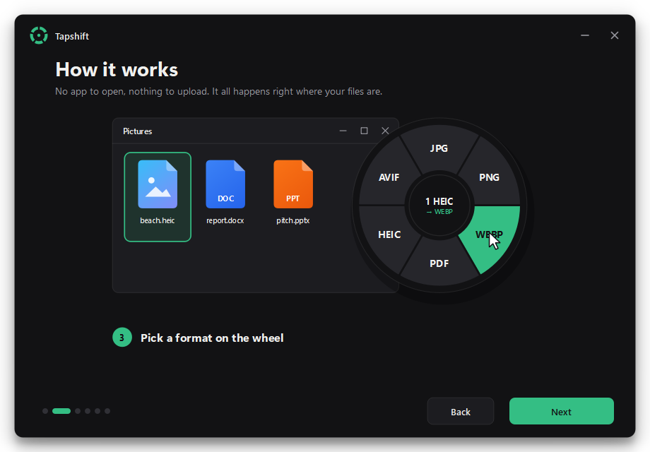
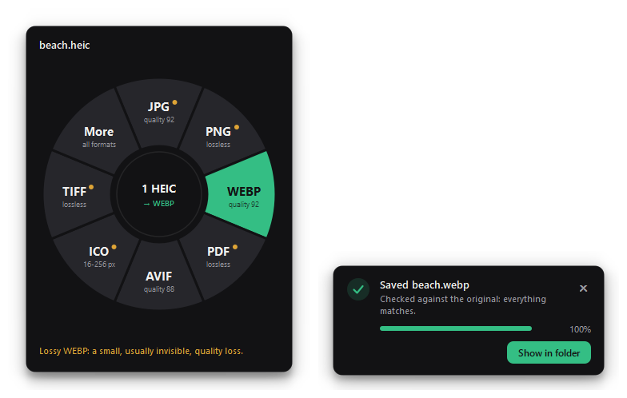
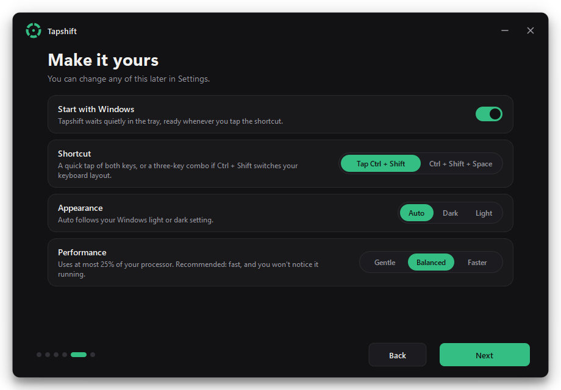

<div align="center">


# Tapshift

**Convert files in a blink. Select a file, tap <kbd>Ctrl</kbd> + <kbd>Shift</kbd>, pick a format.**
The new file appears right next to the original.

[**Download for Windows**](../../releases/latest) · Free and open source (AGPL-3.0) · Windows 10 / 11



</div>

## Why Tapshift

- **No app to open.** It waits in the system tray. Select files in File Explorer or on the Desktop and tap the shortcut.
- **The new file lands next to the original.** `photo.heic` becomes `photo.webp` in the same folder, and nothing is ever overwritten.
- **Every result is double-checked.** Each converted file is opened again and compared with the original: pixels, pages, words, every spreadsheet cell. If anything is off, it's thrown away and you're told why.
- **Private.** Everything happens on your computer. No uploads, no account.
- **Light.** It uses no CPU while idle. Conversions run under a hard CPU limit that Windows enforces (15%, 25% or 50%, your choice), so your laptop stays cool and responsive.

<div align="center">

</div>

## What it converts

| You select | You can make |
|---|---|
| **Images:** JPG, PNG, WEBP, HEIC, AVIF, GIF, BMP, TIFF, ICO, TGA, PSD, SVG, camera RAW | JPG, PNG, WEBP, HEIC, AVIF, GIF, BMP, TIFF, ICO, TGA, PDF, or several images in one PDF |
| **Word:** DOCX, DOC, ODT, RTF, TXT, HTML | PDF, DOCX, ODT, RTF, TXT, DOC |
| **Excel:** XLSX, XLS, ODS, CSV | PDF, XLSX, CSV (first sheet), ODS, XLS |
| **PowerPoint:** PPTX, PPT, ODP | PDF, PPTX, ODP, PPT, PNG or JPG slides |
| **PDF** | PNG or JPG pages, text, split into single pages, merge several into one |

- **Office documents** are converted by your installed Microsoft Office, so they look exactly as they do in Office. Office is opened hidden, read-only and with macros disabled, and it's closed afterwards. Your Office settings are never changed.
- **Images:**
  - The camera's rotation is applied.
  - Camera details (EXIF), GPS and the color profile are kept.
  - Lossless formats are verified pixel for pixel.

## Install

1. Download **`Tapshift-Setup-x.y.z.exe`** from the [latest release](../../releases/latest). No admin rights are needed.
   Prefer not to install? Download **`Tapshift-x.y.z-portable.zip`**, unzip it anywhere and run `Tapshift.exe`.
2. A short welcome tour shows you around and lets you choose your settings.
3. Select a file, tap **Ctrl + Shift**, and pick a format.

> Windows SmartScreen may warn about a new, unsigned app. Choose **More info → Run anyway**.

<div align="center">
 
</div>

## Using it

| Action | How |
|---|---|
| Convert | Select files, tap **Ctrl + Shift**, click a format |
| Change quality or other options | Right-click a format on the wheel |
| See every format | Click **More**, or just start typing (e.g. `pdf`) |
| Close the wheel | Esc, click elsewhere, or tap the shortcut again |
| Convert copied files | If nothing is selected, files you copied with Ctrl + C are used |
| Guide, settings, recent conversions | Right-click the Tapshift icon in the tray |

**About the tap:**
- It only counts when you press Ctrl and Shift alone and let go. Ctrl+Shift+T, Ctrl+Shift+click and other shortcuts keep working as usual.
- If Ctrl + Shift switches your keyboard layout, choose **Ctrl + Shift + Space** in Settings.

<div align="center">
 
</div>

## Build from source

```powershell
python -m venv .venv
.venv\Scripts\python -m pip install -r requirements-dev.txt
.venv\Scripts\pythonw run.pyw                                   # run it
.venv\Scripts\python -m pytest tests -q                          # tests (gentle: 25% CPU cap)
powershell -ExecutionPolicy Bypass -File tools\build_release.ps1 # installer + portable zip
```

Building the installer also needs [Inno Setup 6](https://jrsoftware.org/isinfo.php). Pushing a tag like `v1.0.0` builds the release automatically with GitHub Actions.

**How it's organized:**
- `app/` is the tray app: the shortcut, the wheel, the windows.
- `app/engines/` holds the converters, each with its own safety checks.
- `app/ui/` holds the animated interface.

Conversions run in separate worker processes, so a damaged file can't take the app down.

## License

Tapshift is free software under the [GNU Affero General Public License v3.0](LICENSE). You can use it,
share it and change it; if you distribute a modified version, you must share its source code under the same
license. It comes with no warranty.

It bundles open-source components (Qt, PyMuPDF, Pillow, pillow-heif and others) under their own licenses;
see [THIRD-PARTY-NOTICES.md](THIRD-PARTY-NOTICES.md).
